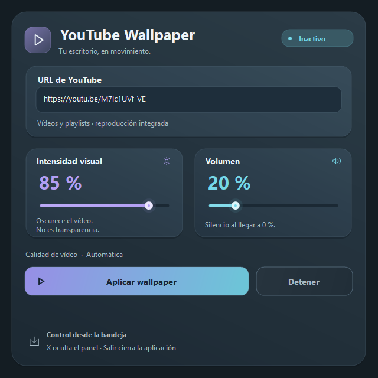

# YouTube Wallpaper

Aplicación WinForms para Windows 11 que reproduce un vídeo o una playlist de YouTube en un host independiente del panel de configuración. Conserva el proyecto original **YoutubeWallpaper**, C# y **.NET 8**; usa Microsoft.Web.WebView2 **1.0.4258.31**.

**Estado del MVP:** compilación Debug/Release y reproducción real comprobadas. El acoplamiento a WorkerW, la continuidad al ocultar el panel y el ciclo de bandeja pasaron pruebas programáticas en esta máquina. Quedan pendientes la comprobación visual detrás de los iconos, los clics físicos, el avance de playlists y cambios reales de resolución/Explorer. Consulta la [matriz de aceptación](docs/VALIDACION.md); no se considera terminada la validación interactiva de la fase B.

## Ejecutar y usar

Requisitos:

- Windows 11 con Explorer como escritorio; este MVP trabaja con el monitor principal.
- [.NET Desktop Runtime 8](https://dotnet.microsoft.com/download/dotnet/8.0), para la publicación dependiente del framework.
- [Microsoft Edge WebView2 Runtime Evergreen](https://developer.microsoft.com/microsoft-edge/webview2/).
- Internet y contenido que YouTube permita reproducir mediante inserción.

Ejecuta **YoutubeWallpaper.exe** como usuario normal. Aparece el panel; nunca comienza a reproducir solo por tener una URL guardada.

1. Pega un enlace HTTPS de vídeo o playlist.
2. Ajusta **Volumen** e **Intensidad visual**.
3. Pulsa **Aplicar wallpaper**. El estado pasa de Cargando a Reproduciendo cuando llega el evento del reproductor.
4. Cierra el panel con **X**. La app permanece en la bandeja junto al reloj o en el menú **^**.
5. Un clic o doble clic en el icono abre el panel. El menú contextual permite abrir, aplicar/reanudar, detener y salir.

**Detener** libera el reproductor y su superficie, pero mantiene la aplicación en la bandeja. **Salir** desde la bandeja termina la aplicación. Puedes aplicar otro enlace para reemplazar el contenido; la instancia anterior se libera primero. Una segunda ejecución señala a la instancia existente para mostrar su panel.

Windows controla si el icono está visible o en **^**; la app no modifica tus preferencias de la barra de tareas. No se configura inicio con Windows ni se modifica el wallpaper estático. No se depende de Zen Browser.

El panel utiliza el diseño oscuro solicitado: superficies redondeadas con sombras suaves, tarjetas para fuente/ajustes y acentos cian y violeta. Los botones reaccionan al pasar el puntero y al presionar; el campo de URL cambia su borde al recibir foco y los deslizadores suavizan el movimiento del indicador. Durante la carga hay un indicador animado. Las transiciones se detienen al ocultar el panel y respetan la preferencia de animaciones de Windows. Los deslizadores conservan interacción con ratón, flechas, Home/End, PageUp/PageDown y un valor accesible.

Enlaces admitidos:

~~~text
https://www.youtube.com/watch?v=M7lc1UVf-VE
https://youtu.be/M7lc1UVf-VE
https://www.youtube.com/playlist?list=PLAYLIST_ID
https://www.youtube.com/watch?v=VIDEO_ID&list=PLAYLIST_ID
~~~

También se admite el host móvil y el parámetro index positivo en playlists. Se rechazan otros hosts, HTTP, puertos ajenos a HTTPS, credenciales en la URL, rutas no admitidas, IDs inválidos y parámetros duplicados. Se eliminan parámetros de seguimiento al normalizar y guardar.

## Intensidad, volumen y calidad

- **Intensidad visual 0–100 %:** aplica un filtro de brillo al reproductor. 0 oscurece la superficie completamente, 50 reduce el brillo y 100 conserva la imagen. **No es transparencia:** no permite ver el fondo estático. Para recuperar el escritorio normal, pulsa Detener. Valor inicial: 85 %.
- **Volumen 0–100 %:** usa setVolume, mute y unMute de YouTube. 0 silencia el reproductor. Se conserva entre vídeos; no se llama a ninguna API de volumen maestro de Windows. Valor inicial: 20 %.
- **Calidad automática:** la decide YouTube. No hay un selector de resolución ficticio ni se manipula su DOM.

La transparencia real de WebView2 bajo WorkerW no se ha verificado. Se eligió explícitamente el oscurecimiento; no se activa Form.Opacity ni WS_EX_LAYERED. El filtro también afecta al aspecto del reproductor, incluida su identificación; no hay una capa superpuesta ni recorte para ocultar anuncios o marca. La validación visual del efecto queda pendiente.

Se utiliza exclusivamente el [reproductor embebido y la IFrame Player API](https://developers.google.com/youtube/iframe_api_reference). No se descargan vídeos, se extraen flujos ni se eluden restricciones de inserción, cuenta, edad o región. Los controles se configuran con parámetros oficiales; la superficie de escritorio es pasiva.

## Cómo funciona el host

WallpaperHost descubre una capa **WorkerW** del proceso de Explorer por debajo del contenedor de iconos **SHELLDLL_DefView**. Examina tanto ventanas superiores como la variante con hermanos bajo Progman. Solicita la creación de la capa con mensajes 0x052C de duración limitada, valida HWND, proceso, clase, visibilidad y orden, y acopla únicamente su ventana propia mediante SetParent.

La superficie usa WS_CHILD, WS_EX_TOOLWINDOW y WS_EX_NOACTIVATE, se deshabilita para recibir entrada y se crea con el contexto DPI del padre. La UI permanece en su propio formulario. Las APIs nativas comprueban resultados y errores; la app nunca destruye, oculta ni cambia estilos de ventanas de Explorer. La [documentación de SetParent](https://learn.microsoft.com/windows/win32/api/winuser/nf-winuser-setparent) explica la necesidad de ajustar estilos y la sensibilidad a diferencias de DPI.

**WorkerW no es una API contractual de wallpapers.** Algunas versiones o configuraciones de Windows pueden tener una composición que esta estrategia no reconozca. En ese caso se muestra un error y se liberan los recursos; no se deja una ventana normal fingiendo ser un wallpaper.

Un monitor de 1,5 segundos comprueba el acoplamiento y reajusta dimensiones/DPI. Si Explorer pierde o recrea la capa, se detiene el host y se solicita **Aplicar** de nuevo. Esta recuperación es manual: no se intenta reiniciar Explorer ni cambiar preferencias del sistema. Su prueba real tras reiniciar Explorer sigue pendiente.

## Datos locales

~~~text
%LOCALAPPDATA%\YouTubeWallpaper\
    settings.json
    diagnostics.log
    WebView2\             perfil del runtime
~~~

El JSON contiene schemaVersion, lastUrl, volume, opacity, qualityMode y visualMode. Para conservar el campo solicitado, opacity guarda el valor de **intensidad**, identificado con visualMode: intensity. qualityMode solo admite auto.

La carga valida los valores, normaliza la URL y recupera defaults ante JSON dañado o versión desconocida. Se guarda al aplicar, al cerrar el panel y tras 500 ms sin cambios de sliders. La escritura usa un archivo temporal, flush y reemplazo en el mismo directorio; ante un bloqueo breve admite dos reintentos de 25 ms. Si falla, informa y conserva el archivo anterior.

El JSON no contiene credenciales, cookies ni tokens. WebView2 mantiene su propio perfil separado, que puede contener datos del servicio; no se exporta ni se indexa en Git. Los diagnósticos locales guardan operaciones fijas, tipo de excepción y HResult, sin URLs completas ni mensajes de excepción. Se limitan a aproximadamente 1 MB; no hay telemetría propia.

## Compilar, comprobar y publicar

Desde la raíz, con SDK 10 y Visual Studio 2026:

~~~powershell
dotnet restore YoutubeWallpaper.slnx
dotnet build YoutubeWallpaper.slnx -c Debug --no-restore
dotnet build YoutubeWallpaper.slnx -c Release --no-restore
dotnet run --project YoutubeWallpaper.Tests -c Release --no-build
dotnet publish YoutubeWallpaper/YoutubeWallpaper.csproj -c Release --no-restore --self-contained false -o artifacts/publish
~~~

Abre **artifacts/publish/YoutubeWallpaper.exe**. Copia **toda la carpeta publish**, incluidos DLL, runtimeconfig, cargadores WebView2 y PlayerAssets; el exe solo no constituye la distribución. El icono está embebido y también se usa como icono del ejecutable. La publicación no instala runtimes, no crea accesos directos y no agrega inicio automático.

La solución .slnx necesita un SDK compatible con ese formato. Con SDK 8 puedes trabajar directamente con los proyectos:

~~~powershell
dotnet restore YoutubeWallpaper/YoutubeWallpaper.csproj
dotnet build YoutubeWallpaper/YoutubeWallpaper.csproj -c Release --no-restore
~~~

Los tests son un ejecutable de validación sin paquetes adicionales. Los modos que tocan el escritorio deben ejecutarse **por separado**, en una sesión normal de Windows, sin elevar la app a administrador:

~~~powershell
dotnet run --project YoutubeWallpaper.Tests -c Release --no-build -- --ui
dotnet run --project YoutubeWallpaper.Tests -c Release --no-build -- --desktop
dotnet run --project YoutubeWallpaper.Tests -c Release --no-build -- --playback https://www.youtube.com/watch?v=M7lc1UVf-VE
~~~

--ui dibuja una vista del panel en artifacts/panel.png. --desktop crea y destruye una superficie temporal sin reproducir. --playback utiliza vídeos reales, comprueba la API y el ciclo de panel/bandeja, y libera sus ventanas al terminar. Los datos de prueba quedan bajo .build/tests, separados de los ajustes de usuario. La prueba puede tardar hasta 45 segundos por carga y utiliza temporalmente el escritorio.

Para renderizar las microanimaciones de los controles reales añade --motion a --ui. Se generan 60 frames PNG en artifacts/motion-frames; estos pueden codificarse como GIF sin capturar contenido del escritorio.

La única dependencia NuGet es la existente. Directory.Build.targets elimina la referencia WPF que esta versión de WebView2 añade a proyectos WinForms; así se evita el conflicto de WindowsBase sin silenciar advertencias. tools/Create-AppIcon.ps1 permite regenerar el icono original del proyecto.

Se mantuvo .NET 8 para este MVP. Su soporte finaliza el **10 de noviembre de 2026**; queda pendiente evaluar y validar la migración a .NET 10 LTS. [Política de soporte de Microsoft](https://dotnet.microsoft.com/platform/support/policy/dotnet-core).

## Solución de problemas

| Situación | Acción |
|---|---|
| Falta WebView2 Runtime | Instala/repara Evergreen y vuelve a aplicar. |
| No se encuentra WorkerW o falla SetParent | Usa una sesión normal de Windows con Explorer; evita ejecutar como administrador. Consulta diagnostics.log. No cambies preferencias del escritorio para forzar el mecanismo. |
| Explorer cambia o el vídeo desaparece | El host se detiene si detecta pérdida de capa. Pulsa Aplicar de nuevo cuando el escritorio esté disponible. |
| YouTube devuelve 101/150 | El propietario impide la inserción. Prueba otro contenido. |
| YouTube devuelve 100 | El vídeo fue eliminado, no existe o es privado. |
| YouTube devuelve 153 | El servicio rechazó la identidad del cliente. La app declara una identidad estable en el manifiesto y envía Referer del host local; la aceptación en una distribución instalada debe verificarse. No se suplanta otro cliente. |
| No se confirma playing en 45 s | Comprueba conexión, runtime, URL y restricciones. El host se libera para evitar dejar una superficie negra. |
| Inicio automático bloqueado | El runtime configura autoplay para el inicio explícito desde Aplicar; el servicio aún puede rechazarlo. Se informa y se detiene. No se automatizan clics en YouTube. |
| Ajustes dañados/no guardados | Se usan valores seguros; revisa permisos de la carpeta de datos. |
| No ves el icono | Busca en ^. Su ubicación depende de Windows. |
| Al cerrar sigue el audio | X oculta el panel. Usa Detener o Salir desde la bandeja. |

El reproductor se sirve desde contenido empaquetado mediante un host virtual HTTPS de WebView2, sin servidor externo propio. Se restringe la navegación superior a ese contenido y se rechazan ventanas emergentes y permisos adicionales. Se envía un Referer explícito a las solicitudes embebidas de YouTube para identificar la app, siguiendo la [documentación de identidad del cliente](https://developers.google.com/youtube/terms/required-minimum-functionality#api-client-identity-and-credentials). No se afirma que esto garantice aceptación de todos los contenidos o distribuciones.

## Git y entrega

La base original se preservó en un commit local antes de implementar. .gitignore excluye bin, obj, .vs, datos personales de Visual Studio, perfiles, logs y artefactos generados. El código, los assets empaquetados y el icono propio sí se versionan.

El repositorio público es [VicWaltzO/YoutubeWallpaper](https://github.com/VicWaltzO/YoutubeWallpaper), con la rama master. Se conservó el historial original y se suben los cambios en commits pequeños después de verificarlos. Las correcciones de interfaz y su documentación tienen commits separados.

Los botones redondeados repintan el fondo en cada frame, incluidos hover, pulsación y estado deshabilitado. Los clics breves muestran respuesta inmediata y el deslizador sigue el cursor durante el arrastre; los cambios por teclado o de valor conservan su transición suave. El porcentaje y la barra se dibujan juntos en una sola superficie con doble búfer para evitar números entrecortados durante los cambios continuos.

La [auditoría](docs/AUDITORIA.md) explica la base encontrada. El [informe de validación](docs/VALIDACION.md) registra resultados y pendientes, incluida la comprobación visual que aún necesita realizarse.
